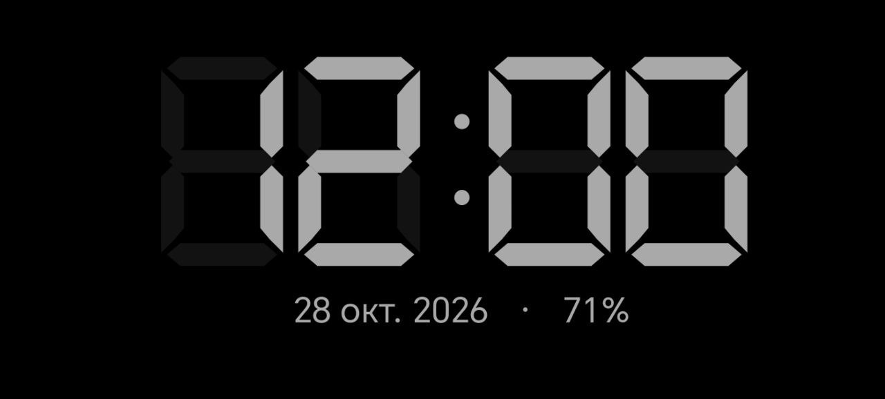
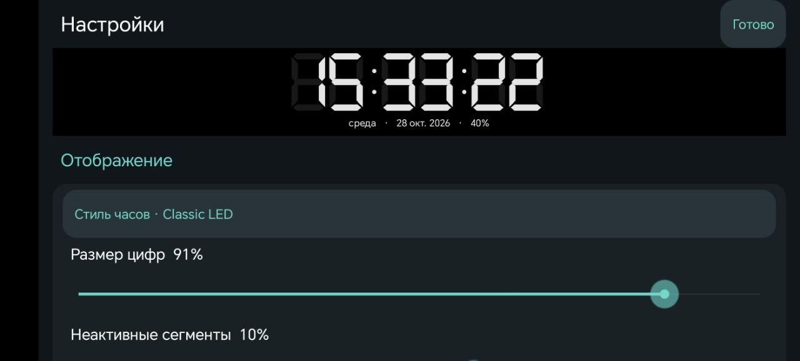
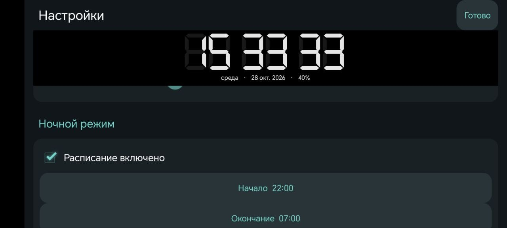

# Simple LED Clock

## 📥 Скачать приложение

Актуальная стабильная версия: **[1.0.3](https://github.com/okbit-it/android-simple-led-clock/releases/tag/v1.0.3)**.

| Версия Android | Скачать APK |
| --- | --- |
| Android 4.0+ | [Скачать для Android 4.0+ (legacy)](https://github.com/okbit-it/android-simple-led-clock/releases/download/v1.0.3/simple-led-clock-1.0.3-android4-plus.apk) |
| Android 6.0+ | [Скачать для Android 6.0+ (modern)](https://github.com/okbit-it/android-simple-led-clock/releases/download/v1.0.3/simple-led-clock-1.0.3-android6-plus.apk) |

Для Android 6.0 и новее выбирайте **modern**. Варианты заменяют друг друга
и не устанавливаются параллельно.

- [Контрольные суммы SHA256 — SHA256SUMS](https://github.com/okbit-it/android-simple-led-clock/releases/download/v1.0.3/SHA256SUMS).
- [Последний стабильный релиз](https://github.com/okbit-it/android-simple-led-clock/releases/latest) — постоянная ссылка.
- [Все релизы GitHub](https://github.com/okbit-it/android-simple-led-clock/releases).

Актуальная версия исходников: **1.0.3**, versionCode **7**.
Публичный репозиторий: [okbit-it/android-simple-led-clock](https://github.com/okbit-it/android-simple-led-clock).

Офлайн-часы для Android с сегментными стилями, цветами, настройками яркости,
ночным расписанием, датчиком освещения, пресетами и защитным сдвигом изображения.
Русский и английский интерфейс. Пакет: `ru.okbit.ledclock`.

## Скриншоты

Основной экран, настройки отображения и включённое ночное расписание 22:00–07:00.
Нажмите на превью, чтобы открыть изображение в полном размере.

<p align="center">
  <a href="docs/screenshots/clock-classic.jpg"></a>
  <a href="docs/screenshots/display-settings.jpg"></a>
  <a href="docs/screenshots/night-schedule.jpg"></a>
</p>

## Сборка

JDK 17, Android SDK Platform 35 и Build Tools 35.0.0; Gradle 8.11.1,
AGP 8.9.3, Kotlin 2.1.20. Настройте Android SDK через `ANDROID_HOME`
или локальный `local.properties` (не включайте его в Git).
Для подписанной release-сборки настройте внешний файл через
`CLOCK_RELEASE_SIGNING_FILE` по [инструкции](docs/RELEASE-SIGNING.ru.md).
Без ключа доступны тесты и lint; выпуск APK будет заблокирован.

```sh
sh ./gradlew :app:assembleModernRelease :app:assembleLegacyRelease
sh ./gradlew :app:testModernReleaseUnitTest :app:lintModernRelease :app:lintLegacyRelease
sh ./gradlew :app:testLegacyReleaseUnitTest -PlegacyAndroid
```

Modern: Android 6.0+ (minSdk 23). Legacy: Android 4.0+ (minSdk 14).
Оба варианта имеют versionCode 7, targetSdk 35 и заменяют друг друга при установке.
PNG launcher icon исправляет воспроизведённый сбой установки на проверенном устройстве.

Начиная с v1.0.3 оба APK используют постоянную подпись OKBIT. Приватный ключ
и параметры подписи хранятся вне репозитория; debug fallback запрещён.
SHA-256 сертификата:
`70F04D575DD893BF063C43BE5B6FBD601BEE269F0D24CDD6A34D1E84FCBD2833`.

**Переход с v1.0.2:** прежняя версия подписана отладочным сертификатом.
Необходимо удалить старое приложение и установить v1.0.3 заново;
локальные настройки и пресеты будут потеряны. Экспорт настроек не реализован.
Для следующих обновлений сохраняется постоянный сертификат OKBIT.

Проверка modern 1.0.2 на HONOR / Android 16 ранее подтверждена пользователем.
Установка и запуск именно v1.0.3 на физических устройствах ещё не проверялись;
это не проверка всех Android-устройств. Внутренние отчёты сборок и история разработки не входят в этот репозиторий.

## Лицензия

SPDX-License-Identifier: GPL-3.0-only

Авторский код Simple LED Clock распространяется под GNU GPL версии 3 **только**.
Полный текст находится в `LICENSE`. Gradle Wrapper и другие сторонние компоненты
сохраняют собственные лицензии и уведомления об авторских правах.

Лицензии зависимостей и границы их распространения: `THIRD_PARTY_NOTICES.md`.
